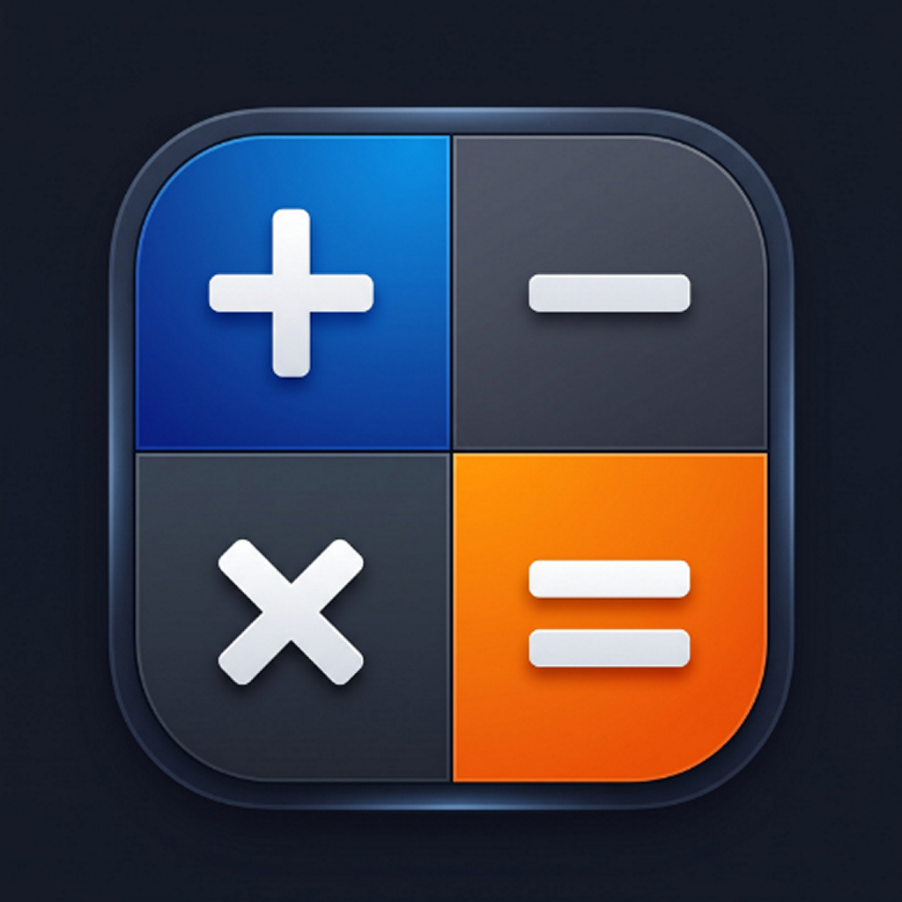

# 🧮 Smart Calc

<p align="center">
  
</p>

<p align="center">
  <strong>Modern, Güçlü ve Kapsamlı Mobil Hesaplama Ekosistemi</strong><br>
  <em>A Modern, Powerful, and Comprehensive Mobile Calculation Ecosystem</em>
</p>

<p align="center">
  <a href="https://play.google.com/store/apps/details?id=com.ismailjacob.SmartCalc">
    
  </a>
  
  
  
  
</p>

<p align="center">
  🌐 <strong>Dil / Language:</strong> 
  <a href="#-türkçe"><strong>🇹🇷 Türkçe</strong></a> • 
  <a href="#-english"><strong>🇬🇧 English</strong></a>
</p>

---

<a id="-türkçe"></a>
# 🇹🇷 Türkçe Dokümantasyon

## 📱 Genel Bakış

**Smart Calc**, **React Native 0.79** (New Architecture etkin) ve **Expo SDK 53** altyapısıyla geliştirilmiş, mobil cihazlar için özel olarak optimize edilmiş modern bir hesaplama ve finans yönetim uygulamasıdır. 

Standart dört işlemden karmaşık trigonometrik ve logaritmik bilimsel hesaplamalara; borsa, stopaj ve kredi analizlerinden döviz ve birim çeviricilere kadar günlük ve profesyonel hayatın tüm hesaplama ihtiyaçlarını tek bir çatıda birleştirir.

* Google Play Store: [Smart Calc İndir](https://play.google.com/store/apps/details?id=com.ismailjacob.SmartCalc)
* Paket Adı: `com.ismailjacob.SmartCalc` | Versiyon: `1.2.7` (Build: `21`)

---

## 🌟 Öne Çıkan Temel Modüller

Uygulama 4 ana sekmeden oluşan sezgisel bir arayüze sahiptir:

```
Smart Calc
├── 🧮 Standart Hesap Makinesi (Anlık önizleme, yüzde, notlu geçmiş)
├── 🧠 Bilimsel Hesap Makinesi (Trigonometri, logaritma, kök/kuvvet, DEG/RAD)
├── 🧰 Araçlar Merkezi (14 adet finans, çevirici ve yaşam aracı)
└── ⚙️ Ayarlar & Özelleştirme (8 tema, yüksek kontrast, çoklu dil, para birimleri)
```

---

### 1. 🧮 Standart Hesap Makinesi (`index.tsx`)
Günlük hesaplamalar için akıcı ve hatasız bir deneyim sunar:
- **Dairesel Buton Mimarisi:** Modern işletim sistemlerinin estetiğine uygun, dokunsal geri bildirim (Haptic Feedback) destekli tasarım.
- **Dinamik Operatörler:** `+`, `−`, `×`, `÷`, pozitif/negatif dönüştürücü (`+/-`), silme (`⌫`) ve tümünü temizleme (`AC`).
- **Gelişmiş Yüzde Algoritması:** Tekli yüzde (`%`), parantezli yüzde ve çoklu yüzde ifadelerini otomatik dönüştüren akıllı matematik motoru.
- **Anında Sonuç Önizleme (Instant Preview):** Eşittir (`=`) tuşuna basmadan önce alt kısımda anlık matematiksel sonucu hesaplar.
- **Kaydırılabilir Gösterge:** Uzun denklemlerin ve basamakların ekrandan taşmasını önleyen yatay/dikey kaydırılabilir yapı.
- **Panoya Kopyalama:** Çıkan sonucu tek tıkla cihaz panosuna kopyalama.
- **Not Destekli Hesaplama Geçmişi:** Yapılan hesaplamaları zaman damgasıyla listeler; her işleme özel açıklama notu (`NoteModal`) eklemenizi, düzenlemenizi veya silmenizi sağlar.

---

### 2. 🧠 Bilimsel Hesap Makinesi (`scientific.tsx`)
Mühendislik, akademik ve ileri düzey matematiksel ihtiyaçlar için tasarlandı:
- **Trigonometri:** `sin`, `cos`, `tan` fonksiyonları.
- **Açı Modu (DEG/RAD):** Derece ve Radyan açı birimleri arasında anında dinamik geçiş.
- **Kuvvet ve Kökler:** `x²` (Kare), `xʸ` (İstenen kuvvet), `√` (Karekök), `10ˣ` (10 tabanında üs), `exp` (Euler üssü).
- **Logaritma:** `log` (Onluk logaritma) ve `ln` (Doğal logaritma).
- **Matematiksel Sabitler:** `π` (Pi = 3.14159...) ve `e` (Euler = 2.71828...).
- **Özel Fonksiyonlar:**
  - `n!` Faktöriyel operatörü
  - `|x|` Mutlak değer
  - `1/x` Çarpmaya göre tersi alma
  - `mod` Modülo (kalan) işlemi
- **Bağımsız Bilimsel Geçmiş:** Standart işlemlerden ayrı tutulan, not eklenebilir bilimsel hesaplama hafızası.

---

### 3. 🧰 Araçlar Merkezi (14 Gelişmiş Hesaplayıcı ve Çevirici)

Araçlar merkezi; **Kategori Filtreleme** (Tümü, Favoriler, Finans, Çevirici, Yaşam), **Favorilere Sabitleme** (kalıcı AsyncStorage hafızası), **Modal Grid Arama** ve **Zengin Analiz Kartı (Analysis Card)** özellikleri ile donatılmıştır.

| Kategori | Araç | Açıklama |
| :--- | :--- | :--- |
| **Finans** | 💱 **Döviz Çevirici** | 37+ dünya para birimi arasında anlık dönüşüm. Veriler Avrupa Merkez Bankası (ECB) tabanlı [Frankfurter API](https://www.frankfurter.app) üzerinden çekilir. Tek dokunuşla para birimi takası (Swap) yapılabilir. |
| **Finans** | 🏛️ **Stopaj & Net Kâr** | Türkiye finansal piyasaları (Borsa, Fon, Mevduat) için 3 farklı mod: <br>• *Bakiye & Kâr:* Portföydeki kâr tutarı ile satıldığında ele geçecek net bakiye.<br>• *Sadece Kâr:* Brüt kâr ve stopaj oranı üzerinden net kâr.<br>• *Alış & Satış:* Alış-satış tutarlarından net kâr ve getiri oranları (zararda stopaj muafiyeti). Hazır oran butonları (%0, %7.5, %10, %15, %17.5). |
| **Finans** | 🏷️ **Alış Maliyeti & Başa Baş** | Yatırım ve ticaret için kâr/zarar ve başa baş (break-even) analizleri: <br>• *Orandan Maliyet:* Satış fiyatı ve kâr/zarar yüzdesiyle birim alış maliyetini bulur.<br>• *Fiyatlardan Kâr/Zarar:* Alış ve satış fiyatlarıyla birim/toplam kâr-zarar ve portföy değer analizi. |
| **Finans** | 🧾 **KDV Hesaplayıcı** | KDV Dahil ve KDV Hariç tutar hesaplama. %1, %10, %20 hazır butonlar ve özel oran belirleme desteği. |
| **Finans** | 💳 **Kredi Hesaplayıcı** | Kredi tutarı, yıllık faiz oranı ve vade (ay) ile aylık eşit taksit tutarı, toplam geri ödeme ve toplam faiz maliyeti hesabı. |
| **Finans** | 🏷️ **İndirim Hesaplayıcı** | Etiket fiyatı ve indirim yüzdesi ile net indirimli fiyat ve tasarruf tutarı tespiti. |
| **Finans** | 📈 **Hisse Tavan - Taban** | Borsa İstanbul (BIST) standartlarına uygun %10 günlük tavan ve taban simülasyonu. Fiyat ve adet bilgisiyle 5-7 günlük kademeli tavan ve taban potansiyeli tablosu. |
| **Çevirici** | 📏 **Birim Çevirici** | Uzunluk birimleri arasında hatasız dönüşüm: Metre (m), Santimetre (cm), Kilometre (km), İnç (in), Feet (ft), Yard (yd). |
| **Çevirici** | 💻 **Binary Çevirici** | 10'luk taban (Decimal) ile 2'lik taban (Binary) arasında anında çift yönlü sayı çevirimi. |
| **Çevirici** | 🔢 **Taban Dönüştürücü** | 2 ile 36 arasındaki tüm tabanlar (Binary, Octal, Decimal, Hexadecimal, Base-36 vb.) arasında serbest dönüşüm. |
| **Yaşam** | 📅 **Tarih Hesaplayıcı** | İki tarih arasındaki gün, hafta, ay ve yıl farkı dökümü. Belirli bir tarihe gün ekleme veya çıkarma. |
| **Yaşam** | 🎂 **Yaş Hesaplayıcı** | Doğum tarihinden yıl, ay, gün cinsinden kesin yaş hesabı ve bir sonraki doğum gününe kalan gün sayacı. |
| **Yaşam** | ⚖️ **VKE (BMI) Hesaplayıcı** | Boy ve kilo değerleriyle Vücut Kitle Endeksi, DSÖ (WHO) sağlık kategorisi (Zayıf, Normal, Fazla Kilolu, Obez) tespiti. |
| **Yaşam** | 🍽️ **Bahşiş Hesaplayıcı** | Restoran ve hizmet ödemelerinde hesap tutarı, bahşiş oranı (%) ve kişi sayısı ile bahşiş toplamı ve kişi başı ödeme tutarı. |

---

### 4. ⚙️ Ayarlar & Özelleştirme (`settings.tsx`)
- **8 Renk Teması:** Varsayılan (Default), Okyanus (Ocean), Orman (Forest), Gün Batımı (Sunset), Mor (Purple), Gül (Rose), Gece Yarısı (Midnight), Minimal/Yok (None).
- **Karanlık / Aydınlık Mod:** Otomatik sistem algılama veya manuel tema seçimi.
- **Yüksek Kontrast Modu (High Contrast):** Görme güçlüğü çeken kullanıcılar için optimize edilmiş yüksek kontrastlı arayüz.
- **Çoklu Dil (Multi-Language):** Türkçe (TR) ve İngilizce (EN) arasında anında kesintisiz geçiş.
- **Varsayılan Para Birimi:** USD ($), EUR (€), TRY (₺), GBP (£) arasından seçim.
- **Açı Birimi Tercihi:** Trigonometrik işlemler için varsayılan Derece veya Radyan seçimi.
- **Ondalık Basamak Yönetimi:** Sonuçlarda ondalık kısımları açma veya gizleme.
- **Haptik Titreşim Desteği:** Tuşlara basıldığında titreşimli geri bildirimi açma/kapatma.
- **Veri & Gizlilik Yönetimi:** Hesap makinesi geçmişini temizleme, bilimsel geçmişi temizleme ve tüm ayarları sıfırlama.
- **Google Play Bağlantıları:** "Uygulamayı Oyla" ve "Diğer Uygulamalarım" yönlendirmeleri.

---

## 🛠️ Teknik Mimari & Paketler

- **Çekirdek:** [React Native](https://reactnative.dev/) `0.79.5` + [React](https://react.dev/) `19.0.0`
- **Uygulama İskeleti:** [Expo](https://expo.dev/) `53.0.20`
- **Navigasyon:** [Expo Router](https://docs.expo.dev/router/introduction/) `v5.1.4` (Dosya tabanlı sekme yönlendirmesi)
- **Matematik Motoru:** [expr-eval](https://github.com/silentmatt/expr-eval) `2.0.2`
- **Yerel Depolama:** [@react-native-async-storage/async-storage](https://github.com/react-native-async-storage/async-storage) `2.1.2`
- **Döviz Kuru API:** [Frankfurter API](https://www.frankfurter.app)
- **Reklam Modülü:** [react-native-google-mobile-ads](https://github.com/invertase/react-native-google-mobile-ads) `16.3.1` (Uyarlanabilir Banner Entegrasyonu)
- **Kullanıcı Deneyimi:** `expo-haptics`, `expo-clipboard`, `expo-font`, `expo-splash-screen`, `@expo/vector-icons`

---

## 🚀 Kurulum ve Yerel Geliştirme

### Gereksinimler
- **Node.js** (v18 veya üzeri önerilir)
- **npm** veya **yarn**
- **Android Studio** (Android SDK 36, NDK 27.1) ya da telefonunuzda **Expo Go**

### Adım Adım Kurulum
```bash
# Depoyu klonlayın
git clone https://github.com/ismailSoylu/SmartCalc.git

# Proje dizinine girin
cd SmartCalc

# Bağımlılıkları yükleyin
npm install

# Metro geliştirme sunucusunu başlatın
npx expo start -c
```

---

## 📦 Android Derleme ve Yayınlama (Release)

Projede Google Play Store ve APK çıktıları için yapılandırılmış Gradle adımları:

```powershell
# 1. Google Play için İmzalı AAB (Bundle) Üretme:
cd android; .\gradlew.bat bundleRelease; cd ..
# Çıktı: android/app/build/outputs/bundle/release/app-release.aab

# 2. Telefona Doğrudan Yüklemek İçin İmzalı Release APK:
cd android; .\gradlew.bat assembleRelease; cd ..
# Çıktı: android/app/build/outputs/apk/release/app-release.apk

# 3. Hızlı Test İçin Debug APK:
cd android; .\gradlew.bat assembleDebug; cd ..
# Çıktı: android/app/build/outputs/apk/debug/app-debug.apk

# 4. Kilitli Gradle İşlemlerini Durdurma ve Temizleme:
cd android; .\gradlew.bat --stop; .\gradlew.bat clean; cd ..
```

> **Önemli Not:** Yeni bir Google Play güncellemesi yayınlarken `app.json` ve `android/app/build.gradle` dosyalarındaki `versionCode` değerini artırmayı unutmayın.

---

<br><br>

<a id="-english"></a>
# 🇬🇧 English Documentation

## 📱 Overview

**Smart Calc** is a modern, high-performance, and feature-complete calculation suite built with **React Native 0.79** (New Architecture enabled) and **Expo SDK 53**, specifically engineered for mobile devices.

From everyday arithmetic to advanced scientific computations (trigonometry, logarithms, roots), and from dedicated investment & tax analysis (withholding tax, cost-basis, stock limits) to real-time currency and unit conversions, Smart Calc is your all-in-one daily mathematical companion.

* Google Play Store: [Download Smart Calc](https://play.google.com/store/apps/details?id=com.ismailjacob.SmartCalc)
* Package Name: `com.ismailjacob.SmartCalc` | Current Version: `1.2.7` (Build: `21`)

---

## 🌟 Core Application Modules

Smart Calc features an intuitive 4-tab bottom navigation structure:

```
Smart Calc
├── 🧮 Standard Calculator (Instant preview, smart percentages, notes & history)
├── 🧠 Scientific Calculator (Trigonometry, logarithms, roots/powers, DEG/RAD)
├── 🧰 Tools Hub (14 specialized financial, converter, and utility tools)
└── ⚙️ Settings & Customization (8 themes, high contrast, multi-language, currencies)
```

---

### 1. 🧮 Standard Calculator (`index.tsx`)
Engineered for smooth, error-free daily math:
- **Circular Tactile Buttons:** Modern mobile design with rich haptic feedback on every tap.
- **Arithmetic Operations:** `+`, `−`, `×`, `÷`, plus/minus toggle (`+/-`), backspace (`⌫`), and All Clear (`AC`).
- **Smart Percentage Parser:** Intelligently handles standalone percentages, compound percentage expressions (`A % B (expr)`), and multi-step calculations.
- **Instant Result Preview:** Displays real-time evaluation before hitting the equals (`=`) button.
- **Scrollable Display Area:** Never worry about overflowing digits or extended algebraic formulas.
- **One-Tap Clipboard Copy:** Tap to copy results straight to your clipboard with toast confirmation.
- **History with Custom Notes:** Review all prior calculations with timestamps. Add, edit, or delete notes for any calculation using the integrated `NoteModal`.

---

### 2. 🧠 Scientific Calculator (`scientific.tsx`)
Built for engineering, academic, and advanced scientific formulas:
- **Trigonometric Functions:** `sin`, `cos`, `tan`.
- **Angle Unit Switching (DEG/RAD):** Toggle between Degree and Radian modes dynamically.
- **Powers & Radicals:** `x²` (Square), `xʸ` (Custom exponent), `√` (Square root), `10ˣ` (Power of 10), `exp` (Euler power).
- **Logarithms:** `log` (Base-10 log) and `ln` (Natural log).
- **Mathematical Constants:** `π` (Pi = 3.14159...) and `e` (Euler's number = 2.71828...).
- **Advanced Operators:**
  - `n!` Factorial
  - `|x|` Absolute value
  - `1/x` Multiplicative inverse
  - `mod` Modulo operation
- **Dedicated Scientific History:** Separate calculation log with individual note editing.

---

### 3. 🧰 Tools Hub (14 Specialized Calculators & Converters)

The Tools hub features **Category Filtering** (All, Favorites, Finance, Converter, Life), **Pin to Favorites** (persisted in AsyncStorage), an **All Tools Modal Grid** with live search, and a **Rich Analysis Card** for detailed financial metrics.

| Category | Tool | Description |
| :--- | :--- | :--- |
| **Finance** | 💱 **Currency Converter** | Real-time exchange rates for 37+ world currencies powered by the [Frankfurter API](https://www.frankfurter.app) (European Central Bank data). Features a one-tap currency swap button. |
| **Finance** | 🏛️ **Withholding Tax & Net Profit** | 3 flexible modes for stock and deposit investors: <br>• *Balance & Profit:* Calculates net payout after tax from total balance and profit.<br>• *Profit Only:* Computes withholding tax and net profit from gross profit.<br>• *Buy & Sell:* Analyzes net return and tax based on buy and sell amounts (tax-exempt on loss). Preset tax chips (%0, %7.5, %10, %15, %17.5). |
| **Finance** | 🏷️ **Cost Basis & Profit/Loss** | Break-even and profit/loss calculator for traders: <br>• *Cost from Rate:* Determines unit purchase cost from current price and target rate.<br>• *Profit/Loss from Prices:* Analyzes profit/loss per unit, percentage return, total cost, and portfolio value. |
| **Finance** | 🧾 **VAT Calculator** | Calculates prices with and without VAT. Includes quick presets for %1, %10, %20, and custom rates. |
| **Finance** | 💳 **Loan Calculator** | Calculates monthly installments, total repayment, and overall interest charges based on loan amount, annual interest rate, and term (months). |
| **Finance** | 🏷️ **Discount Calculator** | Computes discounted final price and exact money saved from original price and discount percentage. |
| **Finance** | 📈 **Stock Ceiling - Floor** | Daily ceiling (+%10) and floor (-%10) price simulation according to stock market rules. Generates 5-7 day progressive limit ladders and capital estimations. |
| **Converter** | 📏 **Unit Converter** | Accurate length conversions between Meter (m), Centimeter (cm), Kilometer (km), Inch (in), Feet (ft), and Yard (yd). |
| **Converter** | 💻 **Binary Converter** | Instant two-way conversions between Decimal (base 10) and Binary (base 2). |
| **Converter** | 🔢 **Base Converter** | Converts numbers between any radix from base 2 to base 36 (Binary, Octal, Decimal, Hexadecimal, Base-36, etc.). |
| **Life** | 📅 **Date Calculator** | Computes exact differences in days, weeks, months, and years between two dates. Supports adding or subtracting days to find target dates. |
| **Life** | 🎂 **Age Calculator** | Calculates precise age in years, months, and days from birth date, with a countdown to the next birthday. |
| **Life** | ⚖️ **BMI Calculator** | Evaluates Body Mass Index from height and weight, categorizing results according to WHO standards (Underweight, Normal, Overweight, Obese). |
| **Life** | 🍽️ **Tip Calculator** | Computes total tip, bill with tip, and bill split per person based on bill amount, tip percentage, and group size. |

---

### 4. ⚙️ Settings & Customization (`settings.tsx`)
- **8 Visual Themes:** Default, Ocean, Forest, Sunset, Purple, Rose, Midnight, and None.
- **Dark & Light Mode:** Seamless automatic system detection or manual override.
- **High Contrast Mode:** Accessibility-focused high-contrast palette for enhanced readability.
- **Multi-Language Support:** Instant runtime switching between English (EN) and Turkish (TR).
- **Default Currency Selector:** Choose between USD ($), EUR (€), TRY (₺), and GBP (£).
- **Angle Unit Preference:** Configure default Degree or Radian mode for trigonometric functions.
- **Decimal Display Toggle:** Show or hide decimal precision in results.
- **Haptic Vibration:** Toggle tactile button vibration on or off.
- **Data Management:** Clear standard history, clear scientific history, or reset all preferences to defaults.
- **Google Play Integration:** Interactive "Rate App" and "More Apps" buttons.

---

## 🛠️ Tech Stack & Dependencies

- **Core Framework:** [React Native](https://reactnative.dev/) `0.79.5` + [React](https://react.dev/) `19.0.0`
- **Application Platform:** [Expo](https://expo.dev/) `53.0.20`
- **Routing:** [Expo Router](https://docs.expo.dev/router/introduction/) `v5.1.4` (File-based tabs layout)
- **Math Engine:** [expr-eval](https://github.com/silentmatt/expr-eval) `2.0.2`
- **Local Persistence:** [@react-native-async-storage/async-storage](https://github.com/react-native-async-storage/async-storage) `2.1.2`
- **Exchange Rates API:** [Frankfurter API](https://www.frankfurter.app)
- **Monetization:** [react-native-google-mobile-ads](https://github.com/invertase/react-native-google-mobile-ads) `16.3.1` (Adaptive Banner Ads)
- **Device & UI:** `expo-haptics`, `expo-clipboard`, `expo-font`, `expo-splash-screen`, `@expo/vector-icons`

---

## 🚀 Getting Started & Local Development

### Prerequisites
- **Node.js** (v18 or later recommended)
- **npm** or **yarn**
- **Android Studio** (Android SDK 36, NDK 27.1) or the **Expo Go** mobile application

### Setup Instructions
```bash
# Clone the repository
git clone https://github.com/ismailSoylu/SmartCalc.git

# Navigate to project directory
cd SmartCalc

# Install dependencies
npm install

# Start development server with clean cache
npx expo start -c
```

---

## 📦 Android Build & Deployment

Production Gradle build commands configured for Google Play and APK generation:

```powershell
# 1. Build signed AAB (Android App Bundle) for Google Play:
cd android; .\gradlew.bat bundleRelease; cd ..
# Output: android/app/build/outputs/bundle/release/app-release.aab

# 2. Build signed Release APK for direct installation:
cd android; .\gradlew.bat assembleRelease; cd ..
# Output: android/app/build/outputs/apk/release/app-release.apk

# 3. Build Debug APK for fast testing:
cd android; .\gradlew.bat assembleDebug; cd ..
# Output: android/app/build/outputs/apk/debug/app-debug.apk

# 4. Stop locked Gradle daemons and clean build cache:
cd android; .\gradlew.bat --stop; .\gradlew.bat clean; cd ..
```

---

## 👨‍💻 Developer & Attribution

* **Developer:** **Nova Orion** ([@ismailSoylu](https://github.com/ismailSoylu))
* **GitHub Repository:** [https://github.com/ismailSoylu/SmartCalc](https://github.com/ismailSoylu/SmartCalc)
* **Google Play Developer Page:** [Nova Orion on Google Play](https://play.google.com/store/apps/dev?id=6946359108152061435)

---

## 📄 License

This project is licensed under the MIT License - see the [LICENSE](LICENSE) file for details.

<p align="center">
  Made with ❤️ by <strong>Nova Orion</strong>
</p>